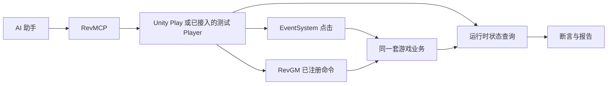

# 🚀 Revolution · 面向 AI 协作的 Unity 游戏框架

Revolution 把 **用同一套规矩写代码、在 Unity 里接好功能、进游戏验证结果** 放进一个开发流程。给游戏加个「领取奖励」按钮，你可以让 AI 写好领取规则、把按钮接进面板，再进游戏点一次，看看金币到底有没有到账。💰

[](RevolutionFrameWork_Unity/Assets/Revolution/package.json)
[](Revolution.RevCLI/README.md)
[](LICENSE)

- 🧱 [第一章 · 让人和 AI 按同一套架构写代码](#architecture)
- 🛠️ [第二章 · 用 RevCLI 操作 Unity](#unity-automation)
- 🧪 [第三章 · 用 RevMCP 和 RevGM 测游戏、找问题](#ai-testing)
- 🎮 [旮旯给木 Revolution.Gal](#gal) · [其他框架能力](#modules) · [安装与文档](#getting-started)

<a name="architecture"></a>

## ❌🔥❤️先把规矩立住，写起代码来才能不烧心

### 😵 AI 写得越快，为什么越要先定规矩？

今天让 AI 做背包，明天做商店，后天做战斗结算。三个功能都能跑，接手时才发现背包直接读文件、商店自带一套资源管理器、结算按钮里塞着发奖和切场景。你本来只想换张按钮图，顺手领到一下午的排查任务。🫠

多人接手、AI 换会话、功能反复迭代，都会遇到同一个问题。**每个人都得知道代码放哪、从哪个入口调用、用完谁收尾。** Revolution 把这些约定写进框架和 Skill。你可以自由设计战斗规则，开发者和 AI 则共用一套加载资源、更新界面和切换流程的方法。

### 📐 同一件事，有大家都找得到的入口

| 碰到什么问题 | Revolution 怎么做 | 做「领取奖励」时会发生什么 |
| --- | --- | --- |
| 🧰 常用功能从哪调用？ | 用公开的 `Rev` 入口。框架把内部细节收起来，代码里常叫这种入口「门面」。 | 奖励图标交给 `RevResManager` 加载，结算面板交给 `RevUI` 打开。 |
| 🚦 现在到哪一步了？ | FSM（有限状态机）管阶段和允许的切换，`RevScope` 管这一阶段里东西能活多久。 | 战斗结束才能进结算。回大厅时，战斗里登记到该域的逻辑和回调随域收尾。 |
| 🖱️ 点一下按钮，谁做什么？ | `RevUIPanel` 负责显示和交互。阶段内的无界面规则放在 `RevLogicBase` 业务单元里，跨阶段共享的能力用 `RevServices` 装配。 | 面板发出「领取」请求，业务判断资格并发奖，面板按返回的结果更新余额和提示。 |
| 🧹 用完谁收？ | 给订阅、计时器和资源指定负责人（`owner`）或作用域。资源取用与释放配对，业务异步用 `RevTask` 并处理取消。 | 退出结算后，加载晚到的图标要归还。玩家都回大厅了，战斗倒计时也该下班。⏰ |
| 📊 奖励从 100 改成 150 怎么办？ | 策划数值从 Excel 导出数据和 C# 表类。项目在启动时校验配置，业务通过 `RevDataTableManager` 等入口读取。 | 策划改表就能调奖励。项目可以在启动时就指出缺了哪个关卡的配置、哪条金币数量超出了范围。 |
| 🔎 出错去哪查？ | 业务返回明确的失败原因，`RevLog` 按模块和级别记日志。 | 「本局奖励已领取」和「奖励配置缺失」能被区分，UI 和测试分别处理。 |

项目一般在启动入口调用一次 `RevInitialize.Initialize()`。从大厅进战斗时，流程控制者推进 FSM，在状态回调里开关对应的 `RevScope`。面板的 `OnBindView` 绑定控件，`OnRefreshView` 把数据更新到屏幕。这样接手的人从按钮一路跟到业务入口，就能找到「为什么只能领一次」的判断。 [官方编程架构规范](Revolution.Document/编程范式/Revolution官方编程架构规范.md) · [UI 分层和刷新时机](Skills/revolution-framework/references/ui-and-layering.md) · [Excel 到运行时的配置流程](Skills/revolution-framework/references/playbooks.md)

### 🤖 Skill 是 AI 入职时拿到的项目手册

Agent 就是可以读代码、调用工具、执行任务的 AI 助手。给它装上对应的 Skill（一套可查的工作说明），它就有地方确认当前版本的公开 API、找同类实现，以及按项目的方式验收。刚上手时，你只需要知道需求属于哪个模块。

| 想让 AI 做什么 | 对应 Skill |
| --- | --- |
| 🧱 写业务和审查代码，确定放面板、Logic 还是服务 | [revolution-framework](Skills/revolution-framework/SKILL.md) |
| 🛠️ 搭场景、挂组件、导表、打包和重连编辑器 | [revolution-unity-editor](Skills/revolution-unity-editor/SKILL.md) |
| 🧪 测玩法、找 Bug、给修改建议、修后回归 | [revolution-ai-automation](Skills/revolution-ai-automation/SKILL.md) |
| 🎬 写分支剧情、调默认面板或接自有界面 | [revolution-gal](Skills/revolution-gal/SKILL.md) |
| 📈 测帧时、查内存和资源瓶颈 | [revolution-performance](Skills/revolution-performance/SKILL.md) |

Codex 插件还提供可审核的会话提醒，以及可接入 Git 和 CI 的项目检查器。项目用 `.codex/rev-policy.json` 声明资产目录和代码范围，检查器可以指出缺失的 `.meta`、重复 GUID 或新增的 C# 规范问题。编译、资源加载和玩法效果仍在对应环境中验证。 [插件与规范检查](Plugin/README.md) · [Skills 安装说明](Skills/README.md)

<a name="unity-automation"></a>

## 🛠️ 从开发者手动操作Unity，到AI自动化操作Unity，彻底解放你的双手

### 🖱️ 脚本写好了，还得挂到场景里

领取奖励的 C# 文件写完，你还得找到结算面板，放一个按钮，挂好脚本和引用，存成 Prefab（可复用的预制体），再点 Play。换关卡或者重做一次 UI，同样的步骤又来一遍。点击鼠标本来是玩家的娱乐，到了你这儿成了每日任务。😄

**RevCLI** 是 Revolution 的命令行工具。开发者或 AI 把目标工程、资产和参数交给它，对应的 Unity 编辑器桥会在主线程执行已注册的动作，返回对象、工单或诊断结果。常用流程因此可以放进脚本，重跑时也能对照同一份参数。 [RevCLI 使用说明](Revolution.RevCLI/README.md)

### ⌨️ 平时在 Unity 点的这些事，都有入口

| 你要做的事 | RevCLI 能帮什么忙 |
| --- | --- |
| 🏗️ 搭场景、摆对象、挂脚本 | 用 `scene.compose` 按一份 JSON 创建对象和组件，用 `script.create` / `script.attach` 生成脚本和绑定，用 `scene.capture` 看相机画面。 |
| 🎨 做 UI、Prefab、材质和动画 | 用 `ui.create` 创建控件，`ui.layout` 读取布局，`prefab.inspect` 查预制体，`material.set` 改材质属性，还能创建动画 Clip 和 Animator。 |
| 🗂️ 处理资产和项目设置 | 用 `asset.find` 找资源，`asset.importer-set` 调导入设置。也能配图集、改项目设置、烘焙光照和导航网格。 |
| 📊 导表、打资源包 | 用 `excel.preview` / `excel.export` 检查和导出配置。AB（AssetBundle）可以按平台增量构建，核对 `ResMap` 映射后再发布到对应的 `StreamingAssets`。 |
| 🧯 看 Console、编译、跑测试 | 查日志和编译错误，启动 Unity Test Runner。构建、测试等长任务可拿工单 ID 查询最终结果。 |
| 📦 构建可运行的游戏 | `ship` 可以串起切平台、导表、打 AB 和构建 Player（独立游戏程序）。热更制作也有清单生成和自检入口。 |
| 🎮 Play 里随手验证一下 | 用 `runtime start` 启动本地运行时服务，再用 `game gms` 查命令。用 `game gm` 或 `game call` 调 GM、点 UI 或读状态。 |

🧩 多项同步操作可以用 `batch.call` 一次发过去。遇到导入、编译或加载等需要等待的步骤，用 `pipeline` 串起动作和检查。比如给三套结算面板挂同一个组件，可以复用一套步骤并读回引用，哪一项没接上，看回执就知道。每次以 `commands --live` 返回的动作与参数为准。 [全链路开发与重启连接](https://yokino337088.github.io/Revolution/自动化工具/RevCLI全链路开发与重启连接使用说明.html) · [增量 AB 构建与发布](Skills/revolution-unity-editor/references/incremental-ab.md)

### 🚀 第一次连接，从查一个场景开始

在本仓库根目录打开 PowerShell。示例使用仓库实测过的 **Unity 2022.3.15f1c1**，RevCLI 和 RevMCP 需要 **Python 3.10+**。`connect` 会检查环境、打开目标工程、等编译并启动常驻服务，电脑重启后也可以用同一个命令连接。初次克隆可用 Unity Hub 打开工程以生成本机版本记录，或在 `connect` 前加 `--unity` 指定 Unity 可执行文件的绝对路径。

```powershell
$revProject = (Resolve-Path './RevolutionFrameWork_Unity').Path
python Revolution.RevCLI/rev.py --project $revProject connect
python Revolution.RevCLI/rev.py --project $revProject --mode live commands --live --query scene.
python Revolution.RevCLI/rev.py --project $revProject --mode live scene list
```

最后一条会列出目标编辑器里已经打开的场景。改了 Unity 脚本时，先退出 Play。在最后一次脚本写入后刷新导入，再用 `editor recompile` 主动完整重编译、`editor wait` 等待就绪、`editor compilation` 核对这次编译已完成且没有错误，之后再进 Play。 [编辑器操作与编译验收](Skills/revolution-unity-editor/SKILL.md)

💡 **RevCLI** 适合日常制作和短操作。**RevMCP** 给 AI 客户端提供已开放的 Editor 和运行时能力，适合有多步断言、跨帧等待、收尾或报告要求的验收。两条入口可用在同一项目里。 [RevCLI 与 RevMCP 怎么选](Revolution.Document/自动化工具/RevCLI与RevMCP怎么选.md)

<a name="ai-testing"></a>

## 🧪 AI自动化测试，并且还能给出测试报告和修改建议，完成开发流程上的闭环

### 🎮 像玩家一样点，像开发者一样查

- 🖱️ **模拟玩家点击。** `ui.dump` 找到 Unity Canvas 界面（UGUI）里的控件。`ui.click` 用 **EventSystem** 检查按钮中心能点到谁，再发送按下、松开和点击事件。按钮中心被弹窗挡住或按钮被禁用时，工具会返回失败。受支持的 UGUI 或 TextMeshPro 输入框可以用 `ui.input` 填文字。项目的棋盘落点、手势或操作时序可以注册自定义输入能力，RevGame 就有一套按屏幕坐标操作的单指接线。 [框架的点击实现](RevolutionFrameWork_Unity/Assets/Revolution/Runtime/RevAutomation/Implementation/RevRuntimeTools.cs) · [RevGame 的单指输入示例](https://github.com/Yokino337088/RevGame/blob/71c55916dfdf9eb9a752b98c4a2b2835bb66c2c2/RevGame_Client/UnityProject/RevGame.Unity/Assets/GameScripts/Automation/Input/GamePointerInput.cs)
- 🧰 **用 GM 准备局面、触发业务。** GM 指令就像开发时留的测试按钮。项目在开发环境用 `RevGM.Register` 登记完整命令名、参数和处理方法。RevMCP 从正在运行的游戏里读取已注册的命令，AI 按发现到的名字和参数调它。测试动作复用玩家走的业务入口。比如准备一局已打完的战斗，再让玩家入口负责「领取」。
- 📏 **用结构化状态判结果。** 项目可通过 `RevRuntimeAutomation.Register` 提供只读查询、受控操作和复位。比如读取领取标记、余额和奖励流水，让 AI 能检查「余额增加了 100」「奖励流水只有一条」。GM 的返回、画面和业务查询可以一起留证。



### 🔌 RevMCP 怎样知道你的游戏有哪些 GM？

MCP 是 AI 客户端连接工具的协议。装好 Revolution Codex 插件后，先用 `rev_bind` 指定 Unity 工程的绝对路径。独立接入其它 MCP 客户端，可以从 Unity 的 **Revolution.Tools → AI → RevMCP 控制台** 获取配置。进 Play 等项目完成注册，再查运行时目录。

| 工具 | 新手怎么用 |
| --- | --- |
| 🔍 `rev_discover` | 查当前实例的能力。指定 `target="gm"` 能看已注册的 GM 名称、说明和参数，按关键字缩小范围。 |
| 🎯 `rev_call` | 执行一个调用。教学场景的 GM 完整名是 `自动化演示/增加`，目录会给出数量参数 `arg0`。 |
| 🧪 `rev_run` | 把多步测试写成一份有断言和清理的计划，方便同样条件下重跑。 |

编辑器 Play 和支持该桥的独立测试 Player 共用运行时注册入口。独立开发版可用 `-revAutomation` 开启本地服务，RevMCP 通过该实例的 `runtime.json` 连接。正式发布默认关闭自动化桥，项目也应把测试用业务命令的注册限定在开发环境。 [RevMCP 接入教程](Revolution.Document/自动化工具/RevMCP使用说明.md) · [GM 注册说明](Revolution.Document/GM指令/GM指令使用说明.md) · [独立 Player 测试](Revolution.Document/自动化工具/独立Player构建与性能自动化.md)

### ✅ 跑一个有结果的 Demo

仓库里的 `RevAutomationDemo` 做了一件很小的事。**计数归零 → 找到按钮并点一下 → 读到 1 → GM 再加 2 → 读到 3 → 截图、查日志 → 最后归零。** 按钮和 GM 共用同一个加法入口，断言读到的是游戏里的计数。 [示例场景](RevolutionFrameWork_Unity/Assets/Revolution.Demo/RevAutomation.Demo/RevAutomationDemo.unity) · [可重跑的测试计划](Revolution.RevMCP/examples/ui-gm.plan.json)

用 Codex 插件时，绑定工程后可以直接把这段话交给 AI。

> 打开 RevAutomationDemo 进入 Play。先查实际按钮和 GM，再跑仓库的 UI + GM 测试计划。确认点击后等于 1，GM 加 2 后等于 3，截图并检查新增错误。结束时归零、退出这次启动的 Play，把报告路径给我。

也可以在已连接、处于编辑模式的 Unity 上，从仓库根目录用终端跑同一份计划。命令行版本会输出 JSON 回执路径。

```powershell
$revProject = (Resolve-Path './RevolutionFrameWork_Unity').Path
$revDemo = 'Assets/Revolution.Demo/RevAutomation.Demo/RevAutomationDemo.unity'
python Revolution.RevCLI/rev.py --project $revProject --mode live editor play --scene $revDemo
python Revolution.RevMCP/rev_mcp.py --project $revProject run Revolution.RevMCP/examples/ui-gm.plan.json
python Revolution.RevCLI/rev.py --project $revProject --mode live editor stop
```

📸 **实测记录**　仓库保留了 2026-10-22 在 Windows 上跑完这条链路的记录。Unity Editor 和独立 Windows 开发版 Player 都有计数为 3 的截图，以及最后归零的回执。 [验证记录与截图](Revolution.Document/自动化工具/验证记录/2026-10-22-RevMCP.md)

### 🧾 报告怎么看，发现 Bug 怎么接着做？

`rev_run` 会顺序执行计划。`expect` 写清楚每一步的预期值，`until` 可以在指定期限内反复查询只读状态，例如等结算真的完成。`finally` 放复位和收尾，执行中的计划失败或取消时也会尝试清理。

1. **覆盖正常、拒绝和重进。** 测「领取奖励」时，第一次领取要加 100 金币，重复领要被拒绝且余额维持原值。回大厅再进下一局时，旧的监听、计时器和领取状态要按规则收尾。
2. **交付现场。** MCP 工具通过 `reportPath` 给出 JSON 回执路径，生成 HTML 报告后也会返回 `evidencePath`。计划可在关键帧截图，连续截图可以合成 GIF。AI 补上环境、覆盖范围、首个失败、清理结果和还待验证的场景。比如遮罩有没有消失看画面，金币有没有到账看状态断言。
3. **定位源码并给改法。** 假如第二次点领取，余额又涨了 100，先保留两次动作与实际余额，再沿着按钮和发奖入口查源码，确认重复请求在哪一步被放行。报告写下复现步骤、代码位置和建议修改点。
4. **修了就用原条件重测。** 如果任务也授权修复，AI 修改后重新编译，复跑原来的失败用例，再看首次领取、重复领取和退出重进。把修前和修后的结果放到同一个缺陷记录里。🔁

[测试计划与断言](Skills/revolution-ai-automation/references/plans.md) · [HTML 报告与证据](Skills/revolution-ai-automation/references/report.md) · [缺陷定位与回归](Skills/revolution-ai-automation/references/defect-closure.md)

<a name="gal"></a>

## 🎮 旮旯给木（Revolution.Gal）· 在 Unity 里写会分支的故事

想让玩家在雨夜选「进店避雨」或「继续赶路」，选了以后还能记住他借没借伞？☔ **Revolution.Gal** 是可选的视觉小说扩展。它把台词、选项、变量、结局和舞台放进 `RevGalStory` 资产，一份剧情可以在工作台试读，也可以直接接进游戏。

### 📝 从第一句话到第一条路线

1. 打开 **Revolution.Tools → Gal → 剧情工作台**，点「快速创建并试读示例」，先看看有两个结局的故事怎么连接。
2. 在节点图里连对白、旁白、选项、自动分支和结局。选项能根据变量决定显示和可用状态。节点里可以指定背景、左中右立绘、背景音乐、语音和音效。
3. 用「章节 / 小节背景」给一组节点共享舞台。小节可以继承章节设置并覆盖背景或材质。用「面板设计器」调控件尺寸、位置和图片，主题资产可统一字体、图集和配色。
4. 用路线测试检查每个选项能否走到预期结局，变量和拒绝结果是否正确。交付游戏时，再用实际的面板、输入和目标平台资源验证播放。

### 🎬 按你游戏的需要接入

| 你要的效果 | 用什么 |
| --- | --- |
| 📖 一整套开箱可用的对话界面 | 工作台生成默认 UGUI 面板，游戏里用 `RevGal.OpenAsync`。自带打字机、自动播放、跳过已读、选项、回看、回退和快速存读档。 |
| 🎨 把剧情接进已有游戏界面 | 用 `RevGalPlayback.Create` 或 `RevGalPlayback.LoadAsync` 拿到 `RevGalSession`，现有 UI 订阅会话帧并提交选项。遇到发道具、切场景这类宿主信号时，由游戏处理后通知会话继续。 |
| 📋 只做剧情配置，交给别人接 | 用工作台「接入检查」核对逻辑路径、变量、信号和媒体，再导出 JSON。项目的打包检查可通过 `RevGalHostContract.InspectMedia` 收集剧情引用的媒体。 |
| 🤖 用一句话改剧情和跑回归 | 让 AI 通过 RevCLI 查节点、预检并提交 `gal node.patch`，接着用 `gal story.test` 跑路线。也可用 `gal ui.layout-set` 调整多个控件。 |

存档记录剧情版本、节点、变量和舞台。默认播放也能记录已读和解锁插画。接进自己的界面时，关闭或换故事由宿主取消未完成的加载并释放会话。 [自定义界面接入](Skills/revolution-gal/references/custom-host.md)

装好 Revolution 核心后，将 `gal` 分支安装到 `Assets/Revolution.Gal`，或通过 Unity Package Manager 添加 Git URL `https://github.com/Yokino337088/Revolution.git#gal`。完整源码工程已包含该扩展。 [Gal 安装与使用](RevolutionFrameWork_Unity/Assets/Revolution.Gal/README.md) · [Gal 给 AI 的工作手册](Skills/revolution-gal/SKILL.md) · [可试读的剧情 JSON](Revolution.RevCLI/examples/gal-story.json)

<a name="modules"></a>

## 🧩 做游戏常用的功能，从这里找

| 我想做什么 | 现成入口 | 从哪里学 |
| --- | --- | --- |
| 🚦 启动游戏、切大厅和战斗 | `RevInitialize` 初始化，`RevScene` 加载场景，`RevLightFSM` / `RevLightStackFSM` 管流程，`RevHeavyFSM` 可组织复杂状态。用 `RevScope` 管阶段内的对象和逻辑。 | [场景](Revolution.Document/场景系统/场景系统使用说明.md) · [状态机](Revolution.Document/状态机/状态机使用说明.md) · [作用域](Revolution.Document/作用域系统/作用域系统使用说明.md) |
| 🎨 打开背包、设置返回和转场 | `RevUI` 管面板打开/关闭、层级和返回，`RevUIPanel` 接数据与控件事件，`RevUIAnim` 做界面动效。 | [UI 系统](Revolution.Document/UI系统/UI系统使用说明.md) |
| 📦 加载图标、Prefab 和配置 | `RevResManager` 按逻辑路径加载并管理引用。支持编辑器直读和 AB 模式。RevAB 工具生成映射、检查依赖、包体积和漏标资源。 | [资源加载与 AB](Revolution.Document/资源加载系统/资源加载系统使用说明.md) |
| ⏱️ 倒计时、等待加载、下一帧再做 | `RevTimer` 定时，`RevTask` 编排可取消的业务异步，`RevMono` 给纯 C# 对象提供帧回调和协程宿主。 | [计时器](Revolution.Document/计时器系统/计时器系统使用说明.md) · [异步与每帧回调](Skills/revolution-framework/references/modules-core.md) |
| 🧰 通知界面，或让多个模块共用服务 | `RevEvent` 派发事件，`RevServices` 注册、获取、注销服务。需要隔离同一接口的多份实例时用 `RevServiceLocator`。框架也提供单例基类。 | [事件](Revolution.Document/事件系统/事件系统使用说明.md) · [服务定位器](Revolution.Document/服务定位器/服务定位器使用说明.md) |
| ♻️ 复用子弹、特效或 C# 对象 | `RevPool` 复用 GameObject，`RevRefPool` 复用纯 C# 对象。 | [对象池](Revolution.Document/对象池/对象池使用说明.md) |
| 🎮 统一键鼠、手柄、触屏的业务动作 | `RevInput` 做动作名绑定、输入屏蔽和手势处理。 | [输入系统](Revolution.Document/输入系统/输入系统使用说明.md) |
| 🔊 播音乐、音效和一段开宝箱演出 | `RevSound` 播放 BGM 与 2D/3D 音效，分类管理音量。用 `RevSequence` 串起播放、等待、并行和取消收尾。 | [音效](Revolution.Document/音效系统/音效系统使用说明.md) · [动作序列](Revolution.Document/动作序列/动作序列使用说明.md) |
| 📊 把策划表变成可读取的数据 | Unity 导表工具和 Windows 版 `Revolution.ExcelTool` 导出 C# 表类和数据文件，运行时通过 `RevDataTableManager` 加载与查询。 | [导表工具](Revolution.Document/导表工具/导表工具使用说明.md) |
| 📱 查前后台切换、裁剪和真机表现 | `RevAppLifecycle` 提供暂停、恢复、退出事件，`RevStripGuard` 帮助发现裁剪问题。运行时性能工具可按测试负载采样帧时和渲染统计。 | [应用生命周期](Revolution.Document/应用生命周期/应用生命周期使用说明.md) · [代码裁剪](Revolution.Document/代码裁剪/代码裁剪使用说明.md) · [性能自动化](Revolution.Document/自动化工具/独立Player构建与性能自动化.md) |
| 🧯 看日志和运行时诊断 | `RevLog` 提供等级、标签、重复抑制与最近日志。开发时还能用 Unity GM 面板和 RevMCP 活动日志查看命令与执行结果。 | [日志系统](Revolution.Document/日志系统/日志系统使用说明.md) · [RevMCP 活动日志](Revolution.Document/自动化工具/RevMCP活动日志与生成路径使用说明.md) |

### 🔄 资源有更新，用 RevHotUpdate

**RevHotUpdate** 是可选的资源热更扩展。从远端清单判断哪些 AB 变了，按包下载、校验并切换版本，失败时可回到可用资源。适合更新图、音频、配置等资源，C# 代码随游戏包发布。仓库有本地假 CDN 的 Demo，可以先在电脑上走完打包、下载和加载。 [资源热更说明](Revolution.Document/热更新/RevHotUpdate使用说明.md) · [热更 Demo](RevolutionFrameWork_Unity/Assets/Revolution.Demo/RevHotUpdate.Demo/README.md)

发布到腾讯云 COS 时，Windows 工具 **Revolution.Could** 会预检产物与上传路径，先传资源、最后传入口清单。仓库也提供 COS / OSS 命令行发布脚本。 [Revolution.Could](Revolution.Could/README.md) · [发布工具与流程](Revolution.Document/热更新/RevHotUpdate使用说明.md#五出包与发布流程)

<a name="getting-started"></a>

## 📦 安装与文档

- 🎮 **第一次体验。** 克隆本仓库，用 Unity Hub 添加 `RevolutionFrameWork_Unity/`，选择已安装的 Unity 2022.3 编辑器。可以从上文实测过的版本开始。模块示例在 `Assets/Revolution.Demo/`，框架本体、Gal 和资源热更的源码在旁边。 [模块 Demo 索引](RevolutionFrameWork_Unity/Assets/Revolution.Demo/README.md)
- 🧱 **已有 Unity 游戏。** 在工程根目录把 `package` 分支安装到 `Assets/Revolution`。核心也支持 Git 子模块和 Unity Package Manager，使用 UPM 前可以查一下资源与生成目录的约定。按需加装 Gal、热更新或 Demo。 [核心安装说明](RevolutionFrameWork_Unity/Assets/Revolution/README.md)
- 🤖 **接入 AI 工具。** Codex 用 Revolution 插件可一起装 Skills、RevCLI 和 RevMCP。其它 Agent 可以安装完整 Skill 目录，或用项目自带的 RevMCP 配置连接。单独下载工具时，让 `Revolution.RevCLI/` 和 `Revolution.RevMCP/` 保持相邻，并确认目标 Unity 工程装了对应桥接代码。 [Codex 插件安装](Plugin/README.md) · [Skills 安装](Skills/README.md) · [MCP 配置示例](Revolution.RevMCP/examples/mcp-config.example.json)

| 要下载什么 | 发布分支 |
| --- | --- |
| 🧱 框架本体与模块示例 | [package](https://github.com/Yokino337088/Revolution/tree/package) · [demo](https://github.com/Yokino337088/Revolution/tree/demo) |
| 🎮 可选扩展 | [gal](https://github.com/Yokino337088/Revolution/tree/gal) · [hotupdate](https://github.com/Yokino337088/Revolution/tree/hotupdate) |
| 🛠️ 编辑器、测试和 AI 工具 | [automation（RevCLI）](https://github.com/Yokino337088/Revolution/tree/automation) · [revmcp](https://github.com/Yokino337088/Revolution/tree/revmcp) · [skill](https://github.com/Yokino337088/Revolution/tree/skill) · [codex-plugin](https://github.com/Yokino337088/Revolution/tree/codex-plugin) |

📚 [在线文档站](https://yokino337088.github.io/Revolution/) · [仓库文档索引](Revolution.Document/README.md) · [框架变更记录](RevolutionFrameWork_Unity/Assets/Revolution/CHANGELOG.md) · [反馈问题](https://github.com/Yokino337088/Revolution/issues) · [MIT 许可证](LICENSE)
