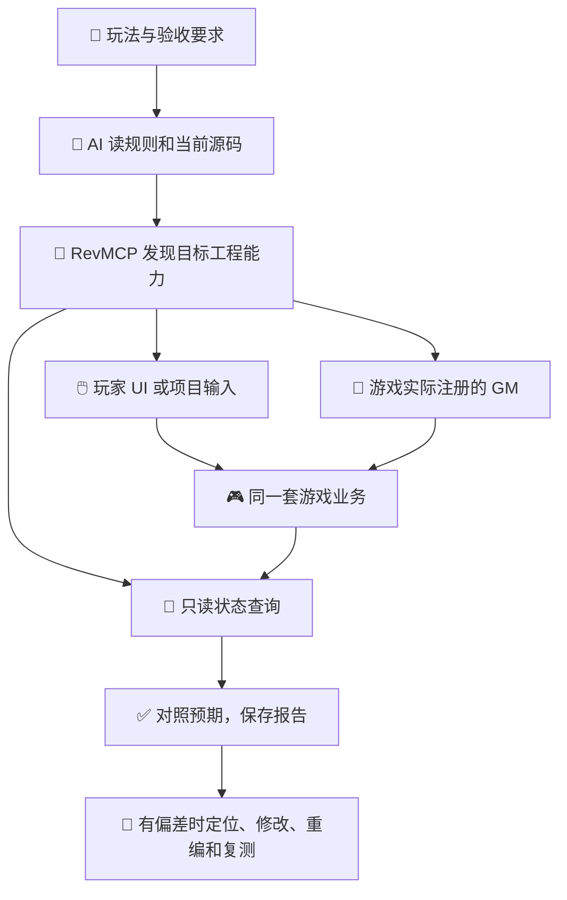

# 🚀 Revolution · 具有革命性的unity客户端框架
## 一万年以后还会有革命

**Revolution 就是「革命」。** 这套 Unity 客户端框架把 📐 **按规矩写代码**、🛠️ **在编辑器里把功能接好** 和 🧪 **进游戏验证结果** 连成一条开发流程。给游戏加个「领取奖励」按钮，你说清楚什么条件能领、应当到账多少，AI 就可以沿着项目已有的入口写代码、接好界面、启动游戏点按钮，再把实测余额交给你。💰

🎮 **RevGame（围棋史莱姆）是这套框架的实践项目。** 它有六章战役、围棋棋盘、Boss、无尽模式和独立剧情。Revolution 从游戏里的真实问题积累做法。关卡要换场景、图集要跨平台打包、AI 要真的落一颗棋子，每件事都有源码或验收记录可查。📚 [RevGame 项目与作者说明][rg-project]

[](RevolutionFrameWork_Unity/Assets/Revolution/package.json)
[](Revolution.RevCLI/README.md)
[](LICENSE)

- 🧱 [第一章 · 把架构规范锁进工程，换个 AI 也能接着做](#architecture)
- 🛠️ [第二章 · 用 RevCLI 把 Unity 操作变成可重跑的步骤](#unity-automation)
- 🧪 [第三章 · 用 RevMCP 和 RevGM 真玩、真测、真定位](#ai-testing)
- 🎮 [旮旯给木 Revolution.Gal](#gal) · 🧩 [其他框架能力](#modules) · 📦 [安装与文档](#getting-started)

<a name="architecture"></a>

## ❌🔥❤️先把规矩立住，写起代码来才能不烧心

### 🧠 大模型本身不会替你的项目记规矩

😵 第一次请 AI 做背包，你告诉它「资源走 `RevResManager`，关面板时记得清理监听」。那次对话里它看得见这句话。第二天你换了个会话做商店，新助手只收到「加个商店」，可能直接读磁盘、另写一套资源管理器。两块界面各自能跑，等第三个人改商店图标，才发现要在两个地方查加载规则。🫠

📨 常说「大模型没有记忆」，在项目里最直接的影响，就是上一段聊天定好的规矩需要再次交给新会话。模型每次根据收到的上下文做判断，聊天产品可以把历史消息、摘要或记忆再次提供给它。项目改了分支、装了新版框架，旧对话里那条 API 签名仍可能过期。**今天适用的架构，应该能从今天检出的仓库查到。** 交接时，新会话第一条消息写「继续做商店」，助手就能从项目入口读到同版本的规则、源码和测试用例。 [模型请求与会话状态](https://developers.openai.com/api/docs/guides/conversation-state)

💬 有责任边界才知道哪里该改。第一次写「领取奖励」，最容易在按钮回调里顺手放发金币、更新标签、播音效、存档和返回大厅。后来加「领取条件」或「失败后重试」，所有人都往那个按钮里加判断。再多两个入口，大家就得猜哪一个发奖函数算数。🔍

### 🔒 「把架构规范锁死」具体锁哪几件事？

📐 先约定 **代码放哪、用哪个公开入口、谁负责收尾、怎样验证**。这里的「锁死」落实到项目接口、规范检查、编译和运行验收。项目要改分层或引入新能力时，可以审查并更新这些约定。AI 平时实现商店、战斗或剧情时，已有的规则直接复用。

| 🧭 要先决定的事 | 🧱 Revolution 的工程约定 | 💰 领取奖励怎么做 |
| --- | --- | --- |
| 🧰 常用功能从哪调用？ | 使用 `Rev` 开头的公开入口。代码里叫「门面」，内部缓存、查找和调度由框架处理。 | 用 `RevUI` 打开结算面板，用 `RevResManager` 按逻辑路径读奖励图标。 |
| 🚦 游戏到了哪一阶段？ | FSM（有限状态机）负责当前阶段和合法转移，`RevScope` 定义这一段玩法的生命周期。 | 战斗结束才能进入结算。回大厅时关闭战斗相关作用域，让登记在里面的逻辑和回调收尾。 |
| 🖱️ 谁能决定是否发奖？ | `RevUIPanel` 显示和接收交互，`RevLogicBase` 装阶段内的无界面逻辑，`RevServices` 装配跨阶段共享的业务能力。 | 面板把点击交给业务。业务验证本局是否结束、奖励是否领过，再返回成功或拒绝。 |
| 🧹 用完谁收？ | 事件、计时器、帧回调和服务有对应的 owner（所有者）或作用域。资源取用和释放要配对。 | 关结算面板后，移除属于它的监听与刷新计时。异步加载晚到时，归还本次拿到的资源。 |
| ⏳ 等待中碰到切场景怎么办？ | 业务异步使用 `RevTask`，等待结束再核对当前请求和对象寿命。 | 玩家退出时取消或终止相关流程，先前的等待结果按原所有者清理。 |
| 📊 策划要把 100 金币调到 150 呢？ | 数值从 Excel 导出，`RevDataTableManager` 加载强类型表，项目启动时校验业务约束。 | 发多少从关卡表读。「领过就拒绝」是业务规则。缺表或数字越界时写出原因。 |
| 🧯 出错怎么找？ | 业务返回可读的失败结果，`RevLog` 按级别和模块记录现场。 | 「奖励已领」「关卡配置没加载」「面板被关闭」各有处理方式，测试也能断言对应结果。 |

### 🧩 用一扇结算面板看懂分工

🚪 **界面知道玩家点了哪里。** 用 `OnBindView` 找控件并接事件，用 `OnRefreshView` 把余额、奖励图标和按钮状态更新到屏幕。玩家点「领取」，回调把请求交出去。数据变了，面板按框架的刷新契约重新显示。再加一个手柄快捷键时，它也可以传同一种领取请求。🎮 [UI 分层与刷新时机](Skills/revolution-framework/references/ui-and-layering.md)

⚙️ **业务知道这次操作能不能做。** 本局阶段、领取资格、奖励记录和钱包变更由业务入口判断。只活在一局里的规则可以由该域的 Logic 编排，跨两张界面共用的存档与钱包可以注册为服务。发奖成功再通知界面，失败结果照样有明确含义。这样做自动测试时，同一个服务也能回答「余额原来是多少、现在是多少」。🧮

🚦 **流程知道现在在哪，作用域知道退出时该收什么。** `RevScene` 加载真正的 Unity 场景，项目的 FSM 在状态回调里开关作用域。战斗结束时，停掉登记在战斗域的 Logic 和回调。大厅公用的图集、存档服务等按它们自己的寿命保留。多个资源使用者共用一张图时，各自归还自己取得的引用。🧹 [官方编程架构规范](Revolution.Document/编程范式/Revolution官方编程架构规范.md#1-总原则常用能力走框架业务只写规则与编排) · [作用域使用说明](Revolution.Document/作用域系统/作用域系统使用说明.md)

⏰ **回收要按所有者核对。** 假如 HUD 每 0.1 秒刷一次数值，HUD 退场时该停的是自己的刷新。暂停域的 Tick（每帧更新）也要留意 Timer 和 Event 的独立契约。要是异步回调在退场后才到，就检查原请求是否仍有效。玩家都打完下班了，过期计时器也不用替大家加班。😄 [资源与释放契约](Skills/revolution-framework/references/resource-and-ab.md)

### 📚 规矩写在哪里，AI 又怎样读到？

🤖 Agent 是能读工程、调用工具、接着做任务的 AI 助手。Skill 是一份能随项目更新的操作手册。Hook（钩子）是到指定时机自动运行的一小段程序。它们和 Git 检查器各管一段，才让「架构锁死」有实际动作。🔧

| 🗂️ 载体 | 👀 什么时候起作用 | 🛠️ 能解决的实际麻烦 |
| --- | --- | --- |
| 📜 仓库规则，比如 `AGENTS.md` | 新开发者或 Agent 从项目根进入 | 告诉它目标 Unity 工程在哪、哪些目录是自己的、当前项目怎么编译和验收。 |
| 📖 Skill | 接到具体任务时加载对应专题 | 写面板查公开 API 与同类面板，打包查真实编辑器动作，找 Bug 查用例、证据和复测方法。 |
| 🔔 会话 Hook | 安装插件并完成信任审核后，由支持的 Codex 宿主在启动、恢复、压缩等会话事件运行 | 给新上下文补一行提醒，让助手重新找到当前项目规则与 Skill。 |
| 🧰 已安装的源码与公开门面 | 写代码、调用工具之前 | 拿当前版本真实存在的类型、重载和参数写业务。旧文章里的范例可以对照职责，调用按项目现状确认。 |
| 🚧 Git Hook 与 CI | 已配置的提交检查、推送或合并请求 | 检查变更里的资产目录、`.meta`、GUID、框架快照和可静态判断的 C# 规则，把违规定位到文件。 |
| ▶️ Unity 编译和实跑 | 脚本接完、准备验收时 | 验证类型、资产接线、切场景和业务后置结果。审查继续判断规则写得对不对、对象是不是在合适的时机回收。 |

🔔 通用 Revolution 插件在识别到安装框架的 Unity 工程时注入简短的开发约定。识别到 RevGame 的项目入口后，由 RevGame 插件把助手引向仓库的 `AGENTS.md` 和 `revgame-development`。Hook 给的是开工提示。真正能拦下违规提交的是已经接好的检查器和对应 CI 门禁。🧱 [Revolution 会话钩子](Plugin/revolution/hooks/session.py) · [RevGame 会话钩子](Plugin/revgame/hooks/session.py) · [插件审核与项目检查](Plugin/README.md)

| 🧑‍🏫 我手上的任务 | 📚 先打开哪份手册 |
| --- | --- |
| 🧱 写业务、看门面、审查资源和生命周期 | [revolution-framework](Skills/revolution-framework/SKILL.md) |
| 🛠️ 搭场景、挂组件、导表、构建、恢复连接 | [revolution-unity-editor](Skills/revolution-unity-editor/SKILL.md) |
| 🧪 亲自测玩法、定位 Bug、给修改建议、做回归 | [revolution-ai-automation](Skills/revolution-ai-automation/SKILL.md) |
| 🎬 写分支剧情、调 Gal 默认面板或接自己的界面 | [revolution-gal](Skills/revolution-gal/SKILL.md) |
| 🎨 做 Shader、材质和特效，查粉屏、图集 UV 及渲染依赖 | [Revolution-TA](Skills/revolution-ta/SKILL.md) |
| 📈 查帧时、内存、GPU 批次和资源寿命 | [revolution-performance](Skills/revolution-performance/SKILL.md) |

### 🎮 RevGame 实践 · 把规矩落到大厅、战斗和数据表

1. 🏁 **`GameBootstrap` 负责开机和装配。** 它调用 `RevInitialize.Initialize()`，用 `RevServices` 登记流程、战斗、资源、音量和存档等能力。图集服务提前实例化，以便在界面请求 Sprite 之前装好监听。业务里的服务引用可以沿这里查到来源。 [RevGame 的启动代码][rg-bootstrap]
2. 🚦 **`GameFlow` 控制屏幕切换。** 大厅和选关在 `StartScene`。进战斗时，`GameFlow` 编排遮罩、预载、`RevScene` 切场景和画面就绪检查。状态进入时打开自己的域，并按需要启动 `BattleLogic`。退出时关闭自己持有的域。AI 若想加「返回大厅」按钮，可以顺着现有流程接线。 [屏幕状态机][rg-flow] · [跨场景交接][rg-flow-scenes]
3. ♟️ **战斗节奏和显示各有归属。** `BattleLogic` 绑定战斗域，停止时收尾敌方 AI 等本局工作。`BattleHudPanel` 的 `OnBindView` 接界面、`OnRefreshView` 更新数值，刷新计时器用面板自己的 owner，释放时按 owner 清理。改一条显示规则，可以先找到 HUD 和它读取的业务数据。 [战斗域 Logic][rg-battle-logic] · [战斗 HUD][rg-hud]
4. 📊 **配置从 Excel 进，数字沿同一路通到界面。** 游戏加载棋子、星级、增益、关卡和敌方阵容等生成表。项目的 `GameConfig` 把表装配成校验后的定义，缺表和不认识的 ID 可以在启动或过场里拦下来。策划改一列数值，代码从同一份数据判断这条规则，提示文字也能引用表里的数。 [项目配置装配][rg-config] · [导表与数据校验](Skills/revolution-framework/references/playbooks.md)
5. 🔎 **项目知道哪些规则可以自动检查。** RevGame 把业务目录、启动入口、资产边界写进 `.codex/rev-policy.json`。本地可以执行 `python tools/RevPolicy/check.py`，提交检查用 `--staged`，CI 用基线提交核对本次变动。移动 Unity 素材时，资产与它的 `.meta` 一起走，保住 GUID 才能保住已有引用。 [项目约定][rg-agents] · [检查配置][rg-policy] · [提交检查][rg-precommit] · [CI 工作流][rg-ci]

📦 **RevGame 的 `Assets/Revolution` 是框架发布快照。** 项目自己的战斗、棋子、剧情、场景和制作规则在 RevGame 写。发现框架共用加载行为出了问题，就到 Revolution 源仓库修、导出相应版本，再同步回项目验证。这样下一位开发者查 Git 就能找到正式修法和生效版本。 [RevGame 的项目入口][rg-project]

### ⚡ 第一章的革命性 · 架构能跟着仓库交接

🤝 换一个 AI 接着加商店时，它从同一个仓库看到「面板负责什么、规则找谁、退场怎么收、怎么验收」。Skill 告诉它先读同类实现，Hook 帮它回到规则入口，检查器把能自动发现的问题提前指出来。团队可以在 Git 里审查**下一位助手也能读到的规则**，新功能因此能按已有工程继续长出来。

🎯 想象两个会话分别做「结算按钮」和「战斗奖励记录」。一个接 `RevUI` 与数据刷新，另一个接现有服务和配置，最后都能沿真实业务入口测领取和重复领取。一份明确的架构把这两份工作接到一起。大家评审时还能把时间花在「这个奖励好不好玩」上。💰

<a name="unity-automation"></a>

## 🛠️ 从开发者手动操作Unity，到AI自动化操作Unity，彻底解放你的双手

### 🖱️ C# 写好了，Unity 里的工作刚做了一半

🧩 回到「领取奖励」。新脚本写出来以后，要进对的场景或 Prefab（可复用的预制体），找到结算面板，挂上组件，接好按钮、文字、图标和资源引用。改了美术还可能要调导入设置、重做图集或更新资源包。最后等 Unity 编译，点 Play 看功能。关错一个窗口，下次还得从头找按钮躲在哪。😄

📌 这些动作会改变 Unity 保存的数据。脚本存在于磁盘上，引用存在于场景和预制体里，资源导入设置跟着 `.meta`。AI 能通过编辑器提供的入口读到真实对象、接上字段、让 Unity 按原本的规则保存。下次接着做，仓库里也能看到发生了哪些变更。🔍

### ⌨️ RevCLI 把编辑器动作变成命令

🔌 **RevCLI** 是 Revolution 的命令行工具。给它目标工程、动作名和参数，Unity 编辑器中的桥接代码就在主线程执行已注册的动作。工具会交回结果。查询对象能拿到对象标识和字段，改引用能读回实际绑定，长任务则可以拿工单 ID 等最终结果。终端、脚本和 Agent 都能走这条路径。 [RevCLI 使用说明](Revolution.RevCLI/README.md)

| 🎯 你想完成什么 | 🛠️ RevCLI 或 Unity 桥提供的操作 |
| --- | --- |
| 🏗️ 搭场景、放对象、接字段 | `scene.compose` 按 JSON 建出对象树，并可给组件设置字段。对象、变换和组件还能分别查改。保存前可以用 `scene.capture` 看相机画面。 |
| 🧑‍💻 写脚本并等它能挂上去 | `script.create` 生成脚本，等本次编译完成再 `script.attach`。挂完用组件查询读回类型与序列化引用。 |
| 🎨 搭 UI 和 Prefab | `ui.create` 创建控件，`ui.layout` 查看屏幕位置与父节点，`prefab.inspect` 检查 Prefab。还可编辑锚点、创建变体和维护引用。 |
| 🗂️ 处理资源和工程设置 | `asset.find` 找指定类型资产，`asset.importer-set` 调导入设置。图集打包项、项目设置和构建平台也有各自的动作。 |
| 🎬 调材质、动画和场景预览 | 能创建或调整材质、动画 Clip、Animator 控制器，提交光照、导航网格等编辑器任务，按回执检查当前结果。 |
| 📊 做 Excel 导表 | 预览会读取字段和内容，导出可以生成 C# 表类与运行时数据。改数值时可以按项目现有的导表方式只更换数据。 |
| 📦 做 AB（AssetBundle）和发布产物 | 可按平台扫描分包、依赖和映射，打全量或增量包，生成热更清单并自检。 |
| 🧯 查日志、编译、跑 Unity Test Runner | 从 Console 取真实错误，主动重编译并对照工单。长任务可以提交后查询状态和结果。 |
| 🚚 出独立游戏程序 | `ship` 能串起切平台、导表、打 AB 和构建 Player。构建回执会记录哪一步失败、最后有无可用产物。 |
| 🎮 Play 内查状态和点几下 | `runtime start` 后，用 `game gms` 查命令，`game gm` 调 GM，`game call` 调已经注册的 UI 或业务能力。 |

💡 **动作清单要从目标工程读。** `commands.json` 便于离线看手册，`commands --live` 会去问在线 Unity 自己注册了什么。比如项目没装 Gal，或者编译后桥接尚未就绪，对应动作就可能缺席。Agent 先按关键字发现，再按返回的参数契约调用。类似「挂脚本」的请求也要先确定目标对象唯一。 [通用 Unity 自动化](https://yokino337088.github.io/Revolution/自动化工具/RevCLI与RevMCP通用Unity扩展使用说明.html)

### ⚙️ 真正省下来的是什么？

- 📋 **一套配置可以重复用。** 比如三张结算面板都用同一个奖励控件，一次写好目标、组件和要接的引用。后来资源名改了，可以更新这份配置，按同样的方式读回三张面板。谁的按钮还没接上，工单里查得到。
- ⚡ **可在同一编辑帧完成的多项操作，可以一次往返。** `batch.call` 把一组同步动作发给 Unity，最多 64 步，前面查到的对象 ID 可以传给后面的动作。一次查十个对象或接多个相互相关的字段时，就能省下反复启动命令和等待回复的时间。📨
- ⏳ **需要等待的事有顺序。** `pipeline` 可把导入、编译、查错、下一步操作和收尾串起来。比如脚本导入后等 Unity 完成重编译，再挂组件。这样失败时手上有具体步骤，查完当前工单再决定能否继续。
- 🔄 **同一编辑器可以继续接着干。** `connect` 能检查对应工程和 Unity 安装、等待编译、启动常驻服务并核对能力。电脑重启后还用同一入口。长任务的接单、运行、完成可以分开查询，构建正在跑时尤其有用。📦

🧱 `scene.compose` 适合一份 JSON 描述整组新对象。它先校验配置，创建中途失败会撤回这次创建的对象。普通批处理则按步骤返回结果，已经完成的动作按任务需要核对和清理。📌 因此「建一整组摆设」和「顺手查三张已存在的面板」可以用各自适合的入口。 [批处理和工单示例](Revolution.RevCLI/README.md) · [场景装配和重连实测](https://yokino337088.github.io/Revolution/自动化工具/RevCLI全链路开发与重启连接使用说明.html)

### 🧱 一次「把领取奖励接进 Unity」可以这样完成

1. 🎯 **先找到真实对象。** 确认正在操作的 Unity 工程、场景和 Prefab 路径。读结算面板的层级、组件与已有绑定，选好要写回的是场景实例还是可复用的 Prefab。
2. 🧑‍💻 **接代码时先核对编译。** 在编辑模式写完最后一次脚本，刷新资源和脚本导入。调用 `editor recompile`，用 `editor wait` 等到就绪，再读 `editor compilation`，确认诊断对应本次工单且没有编译错误。🧯
3. 🔗 **挂组件、设字段、保存。** 给正确的对象挂脚本，填上按钮和文字引用。读回组件和属性，确认引用到了预期对象，有需要时再保存 Prefab 或场景。
4. 📸 **查配置和效果。** 编辑态可检查 UI 布局与对象状态。看 Play 里的最终界面，用运行时截图捕获 Game 画面。相机预览和运行时 UI 合成各有各的用途。
5. ▶️ **进 Play 做业务验收。** 点真实按钮，才知道玩家能不能点到、金币实际加到哪、重复领取时会发生什么。验收用的状态与报告交给第三章的测试流程。🧪

📍 **动手前先认工程。** Revolution 源仓库里的教学工程叫 `RevolutionFrameWork_Unity`。RevGame 的真实工程在它自己的 `RevGame_Client/UnityProject/RevGame.Unity`。同一台电脑可能开着多个 Unity，工具用绝对路径指向要操作的工程。已打开的编辑器走 live。需要无人值守构建时，可以对关闭的工程使用适用的 batch 动作。 [编辑器 Skill 和本次编译的核对方式](Skills/revolution-unity-editor/SKILL.md)

### 🚀 新手上手 · 从列出场景开始

💻 在 Revolution 仓库根目录打开 PowerShell，安装 **Python 3.10+**，以及 Unity 2022.3 编辑器。本文历史验收使用的是 **Unity 2022.3.15f1c1**。第一次克隆可以用 Unity Hub 打开工程生成本机版本记录，也可以在 `connect` 前加 `--unity` 指定编辑器可执行文件的绝对路径。🔧

```powershell
$revProject = (Resolve-Path './RevolutionFrameWork_Unity').Path
python Revolution.RevCLI/rev.py --project $revProject doctor
python Revolution.RevCLI/rev.py --project $revProject connect
python Revolution.RevCLI/rev.py --project $revProject --mode live commands --live --query scene.
python Revolution.RevCLI/rev.py --project $revProject --mode live scene list
```

🔍 `doctor` 查看本机依赖和桥接状态。`connect` 连到正确的编辑器。最后两条分别查已注册的场景能力和当前打开的场景。想看看某个动作需要什么参数，可以继续用 `commands --live --action scene.compose` 看指定动作的契约。📖 [重连与开机检查](Skills/revolution-unity-editor/references/reconnect.md)

💬 在 Codex 里也可以让 AI 做这套操作。

> 🛠️ 连接 Revolution 的 Unity 教学工程。先列出场景，再查当前选中的物体和组件。给我场景路径和真实查询结果。

### 🎮 RevGame 实践 · 从一张 Excel 到游戏里确实换了台词

📊 **2026-11-06，项目替换了鸦鸦的 36 条战斗台词。** 开发动作落在配置表、字体、AB 和游戏画面四个地方。只看到 Excel 被改了，还无法判断玩家玩起来读到了哪份文件。那次记录从源数据一路核对到 Unity 实际落屏。 [鸦鸦台词导表与 PC 资源包验收][rg-export-report]

1. 📝 **先核对源表。** 改的是 `YayaReactionLine` 的 36 个文本字段。表里其他字段与分类规则继续按原表。用 `excel.plan`、`excel.read`、`excel.export` 查导出计划、读取真实表，再导出。报告记录这次写入了台词数据，生成代码保持原样。
2. 🔤 **让新增文字有可用字形。** 编译通过之后，游戏还需要用到字库。记录里重新生成字库并核对 1749 个字符可用。一个字缺失，可能一切都「运行成功」，但字幕里留下一个小方框。▫️
3. 📦 **沿项目配方生产 PC AB。** 调用项目的构建入口和框架的 AB 工具，检查依赖、映射和构建结果。该次记录对构建输出与 `StreamingAssets/PC` 中 155 个非 `.meta` 文件核对了 SHA-256。
4. 🎮 **从真正的 AB 冷启动进战斗。** 用隔离的 Play 会话进第一章，等棋盘、手牌与过场就绪，再触发三档台词的正式分类入口。对照实际返回的 `lineId` 与表里文本，核对无遮挡。回大厅再进一次，仍读取和显示这份新数据。

📸 这次的交付有源表到游戏画面的证据，还写清了验证的是 Windows Editor 真实 PC AB。对于策划，一次改台词就得到了「游戏显示了哪一行」的答案。对于接手的人，每一段的工单和报告都能复查。 [台词实测画面与完整记录][rg-export-report]

### 📦 RevGame 实践 · 通用工具和项目构建配方一起工作

🧩 **框架处理通用 Unity 操作，项目决定怎样给自己的游戏分包。** RevGame 的 `GameResourceBuild` 把美术资源、图集、场景、材质和配置数据纳入同一套构建规则。图集是否都有明确归属、生产包用了哪些图片、逻辑路径指向哪个包，由项目检查。这样新增关卡资源时，AI 可以运行已有配方。 [RevGame 资源构建源码][rg-resource-build] · [资源动作注册][rg-resource-actions]

1. 🏷️ **先核对资源规则。** 分包、引用或图集归属有改动时，发现并使用项目的 `game.resources.configure`，再核对 `game.resources.validate`。只改已有包里的内容时，先按项目已有分包做验证，再进入构建。
2. 🔨 **为明确的平台构建。** RevCLI 的 `ab build-incremental` 接受显式 BuildTarget。做 Windows Editor 的 PC AB 验收可用 `StandaloneWindows64`，出 Android 产物使用 `Android`。产物与平台一起核对。
3. 🗺️ **检查映射和依赖。** 用同一目标的 `ab check-map` 检查映射和构建产物，确认通过后再 `ab publish-incremental`，把已完成的同平台产物同步到 `StreamingAssets`。
4. 🔍 **看发生了什么。** 新平台、首次构建或缓存异常时，本次可能回退到全量构建。成功回执的 `rebuildReason` 会解释原因。发布时记录实际更新、移除的包，随后在正确的资源模式下验证游戏启动与使用。🎮

📦 这里的「发布增量 AB」是把资源产物同步到项目对应平台目录。云端资源热更还需要自己的清单与上传步骤。知道这两步的边界，测试报告就能写明「这次更新了游戏里读取的 PC AB」，以及验收在哪个环境做的。 [增量 AB 步骤与回执字段](Skills/revolution-unity-editor/references/incremental-ab.md)

### ⚡ 第二章的革命性 · AI 能把功能装进工程，还能读回验证

🛠️ 一次 Unity 工作终于可以连着做完。先查已有对象，拿结果生成脚本和资产配置，等编译，挂载，再读回实际引用。开发者把精力留给玩法、手感和美术判断，Agent 能处理那些原先要逐个打开窗口操作的步骤。过两周再给第四个关卡套同一套资源规则，这份制作方法仍能照着跑。🔁

🤝 **RevCLI** 适合编辑器制作、日常导表、构建与简单 Play 操作。**RevMCP** 把已开放的 Editor 和游戏能力交给 AI 客户端，适合在多步验证里查状态、等几帧、跑断言和留报告。两个入口针对的是同一个工程，制作好以后可以直接进入下一段验收。 [RevCLI 与 RevMCP 怎么选](Revolution.Document/自动化工具/RevCLI与RevMCP怎么选.md)

<a name="ai-testing"></a>

## 🧪 AI自动化测试，并且还能给出测试报告和修改建议，完成开发流程上的闭环

### 🔎 「写完了」之后，游戏里到底发生了什么？

💰 领取按钮亮了，点完也播了音效，玩家钱包却没到账。另一次正常加了钱，连点两下又领了一份。还有一种情况更有迷惑性，奖励确实到账了，回大厅后上一局的刷新仍在跑。光看按钮截图，很难把这三件事都查清楚。📸

🧪 **自动验收要把「预期」和「实际」放在一起。** 先记录余额与领取标记，通过真实操作领取，再查询余额和记录。接着试重复领取、退出重进、加载中取消等与功能相关的路径。AI 从结果继续决定下一步检查什么，发现偏差时还能沿当前源码找原因。🔍

### 🧰 RevMCP、RevGM 和业务接口分别做什么？

🔌 **MCP** 是 AI 客户端连接工具的协议，**RevMCP** 是 Revolution 提供的服务端。AI 通过它发现并使用当前工程开放的 Editor、运行时 UI、GM 和业务能力。**RevGM** 是游戏里的命令系统，负责登记命令、解析参数、调用处理函数并返回结果。项目提供的查询与动作，则把真正的业务状态交出来。🎮

| 🧩 角色 | 🛠️ 做什么 | 💰 测领取奖励时的用途 |
| --- | --- | --- |
| 🤖 Coding Agent | 理解需求、看源码、组织用例、解读结果，按授权修改和复测 | 找出首次领、重复领和退出重进的预期，追踪具体发奖入口。 |
| 🔌 RevMCP | 发现当前实例能力，执行调用或测试计划，保存回执和证据 | 调 UI、GM、状态查询，把每一步的输入和实际响应留好。 |
| 🧰 RevGM | 用命令名和参数调用项目登记的处理函数 | 查询本局阶段，准备合法的测试局面，触发玩家共用的业务入口。 |
| 📏 运行时业务接口 | 用 `RevRuntimeAutomation.Register` 登记结构化查询、动作和复位 | 把余额、发奖记录和面板状态作为可精确比对的数据返回。 |
| 🖱️ 玩家输入入口 | 从真实控件或项目输入适配器发送事件 | 点击「领取」，让遮挡、禁用、阶段校验和发奖流程都实际生效。 |

🔗 同一轮测试可以把这些入口放在一起。AI 用 GM 准备一个奖励可领的局面，点击真实面板，再查业务状态。读不到的字段，可以在开发授权内补一个最小的只读查询，复用项目已有服务和所有者清理方式。 [自动化接入与注册](Skills/revolution-framework/references/automation-integration.md)



### 🔍 AI 怎样拿到游戏当前的 GM？

🏁 项目启动或进入对应业务阶段时，用 `RevGM.Register` 登记命令。每条命令有完整名称、说明和参数契约，处理函数调用项目自己的 Service、Logic 或流程控制者。RevMCP 读取 `RevGM.Commands` 等运行时注册信息，AI 因此能查到**这个实例、这个阶段实际登记的命令**。📋 [GM 公开门面](RevolutionFrameWork_Unity/Assets/Revolution/Runtime/RevGMCommand/Facade/RevGM.cs) · [运行时能力注册](RevolutionFrameWork_Unity/Assets/Revolution/Runtime/RevAutomation/Facade/RevRuntimeAutomation.cs)

1. 🎯 **绑定到工程。** 使用 Revolution Codex 插件时，先 `rev_bind` 指定 Unity 工程绝对路径。RevGame 的目标就是它自己的 `RevGame_Client/UnityProject/RevGame.Unity`。
2. 🔍 **发现能力。** 进入所需的 Play 阶段后调用 `rev_discover`，可传 `target="gm"`，再用 `query` 找相关命令。编辑器制作能力用 `target="editor"`，业务和 UI 用 `target="game"`。
3. 🎯 **按真实名字调用。** `rev_call` 的 `action` 填发现到的完整 GM 名。比如教学场景的 `自动化演示/增加` 接受数量参数 `arg0`。项目的命令按实时返回的参数来传。
4. 🔁 **阶段或实例变了就重新查。** 切场景、退出重进、脚本重载后，命令和对象 ID 都可能变化。AI 从新目录和状态继续判断，避免把上一局的对象拿到下一局使用。

🧰 RevGame 已在开发态登记 `RevGame/快照`、`RevGame/打开选关`、`RevGame/进入战斗`、`RevGame/开始战斗` 等命令。进入战斗会走 `GameFlow`，开战会走 `BattleLogic`。同一个游戏可以提供很多受控测试按钮，具体哪几条适合当前用例，由 AI 结合目录、业务前置和源码来选。 [RevGame 的真实命令注册][rg-gm]

🖥️ 编辑器 Play 和支持运行时桥的独立测试 Player 可以共用这套注册方式。开发版 Player 用 `-revAutomation` 开启本地服务，RevMCP 指向该实例的 `runtime.json`。普通发布默认关闭自动化桥，项目把测试命令限定在允许的开发环境。开发者还能在 **Revolution.Tools → AI → RevMCP 控制台** 查看活动日志、参数、结果和工单。📋 [RevMCP 使用说明](Revolution.Document/自动化工具/RevMCP使用说明.md) · [独立 Player 测试](Revolution.Document/自动化工具/独立Player构建与性能自动化.md)

### 🖱️ 「模拟玩家真实输入」怎样落地？

🎮 框架的 `ui.dump` 查询当前 Canvas 界面的控件。`ui.click` 计算控件中心，让 Unity 的 **EventSystem** 做命中检查，然后发出按下、松开和点击事件。按钮被禁用、中心被遮住或没有接收点击的对象，调用会失败。受支持的 UGUI 或 TextMeshPro 输入框还可以用 `ui.input` 填文字。 [框架 UI 输入实现](RevolutionFrameWork_Unity/Assets/Revolution/Runtime/RevAutomation/Implementation/RevRuntimeTools.cs)

♟️ RevGame 的棋盘有自己的 `GamePointerInput`。它从屏幕坐标走 EventSystem 射线，确认最上层目标，把按下和后续松开连起来，落子仍经过游戏已有的阶段与合法性判断。这样「手牌没选」「棋盘格被占」「过场还在」都能在真正的操作链上表现出来。 [RevGame 玩家指针输入][rg-pointer]

📖 书页拖动需要持续移动和松手，RevGame 又把自己的拖页事件链开放为 `memories.drag`。测试可以按住书页边缘，移动一点后松手，验证它回弹，再拖过阈值看是否翻页。框架提供通用点击，项目把自己的手势与业务输入适配成可发现的能力。🖐️ [RevGame 收藏书输入与状态接口][rg-memory-automation]

### 📏 断言是什么，为什么需要它？

✅ 断言就是一句写得很明确的检查。比如「余额等于 100」「棋子总数增加 1」「返回大厅后本局没有活动计时器」。条件写清楚，同样的输入就可以在修改前后重复比对。一个请求返回 `success=true` 后，下一步继续看它承诺的业务后置结果。🔍

| 🧪 操作 | 📏 可以核对的结果 |
| --- | --- |
| 💰 点一次领取奖励 | 余额增加配置里的数量，领取标记已写入，奖励记录增加一条。 |
| 🚫 再点一次领取 | 返回重复领取的拒绝结果，余额与奖励记录保持上一步的值。 |
| ♟️ 手牌落到空格 | 合法落点出现对应棋子，可用手牌或额度扣一次，占格和界面一致。 |
| 🚧 落到被占的格子 | 操作被拒绝，手牌、额度、占格与操作前一致。 |
| 🚪 返回大厅后再开一局 | 本局规则重新初始化，旧事件、输入状态和临时资源已经按所属生命周期收尾。 |

🧩 `rev_run` 接收多步计划，`expect` 写精确预期，`until` 在有限期限内轮询明确声明只读的查询，`finally` 放收尾。比如「开始进入战斗」刚返回时，资源可能仍在加载，要等 `IsTransitioning=false`，再查屏幕和棋盘就绪。⏳ [计划、等待与断言](Skills/revolution-ai-automation/references/plans.md)

### ✅ 跑通一个小 Demo，再换成自己的玩法

🔢 Revolution 自带的 `RevAutomationDemo` 用按钮和 GM 操作同一个计数。完整步骤是 **归零 → 找到按钮并点击 → 读到 1 → GM 加 2 → 读到 3 → 截图、查日志 → 最后归零**。只要把「计数」换成自己游戏能查询的真实状态，就能理解更大的测试怎么组织。 [示例场景](RevolutionFrameWork_Unity/Assets/Revolution.Demo/RevAutomation.Demo/RevAutomationDemo.unity) · [完整计划](Revolution.RevMCP/examples/ui-gm.plan.json)

💻 在已连接且处于编辑模式的教学工程上，可以从 Revolution 仓库根目录用终端复跑这份计划。命令行 `run` 输出 JSON 回执路径，MCP 的 `rev_run` 还会生成对应的 HTML 证据报告。

```powershell
$revProject = (Resolve-Path './RevolutionFrameWork_Unity').Path
$revDemo = 'Assets/Revolution.Demo/RevAutomation.Demo/RevAutomationDemo.unity'
python Revolution.RevCLI/rev.py --project $revProject --mode live editor play --scene $revDemo
try
{
    python Revolution.RevMCP/rev_mcp.py --project $revProject run Revolution.RevMCP/examples/ui-gm.plan.json
}
finally
{
    python Revolution.RevCLI/rev.py --project $revProject --mode live editor stop
}
```

🤖 使用 Codex 插件时，可以直接给助手这个请求。

> 🧪 打开 RevAutomationDemo 并进 Play。发现当前按钮和 GM，执行仓库的 UI + GM 测试计划。点击后断言 1，GM 加 2 后断言 3，截图并检查错误。最后归零，退出本次启动的 Play，给我报告和清理结果。

📸 仓库保留了 **2026-10-22** 在 Unity Editor 与独立 Windows 开发版 Player 跑这条链的记录。计数为 3 的截图和最后归零的回执都在报告里。 [历史验证记录](Revolution.Document/自动化工具/验证记录/2026-10-22-RevMCP.md)

### ♟️ RevGame 实践 · AI 真正在第一章里选牌、落子和开战

🎮 **2026-10-23 的一份记录，测试方式是边读棋盘边决定下一步。** AI 查询敌我位置、血量、手牌和合法落点，再通过指针入口操作。报告记下了 11 个回合的胜利、61 次成功落子，以及两次被拒绝的操作，最后领取章节奖励并进入第二章准备。每次落子都回读额度与棋子数。 [第一章 AI 实时决策游玩记录][rg-play-report]

1. 🔍 **先看局面。** 哪张牌在手里、哪些点合法、敌人站哪、有多少血，都由当前运行的游戏查询。AI 再决定先下哪张牌、往哪放。
2. 🖱️ **按玩家路径操作。** 选手牌、点格子、按开始战斗，走真实输入入口。报告中有一次点到了已有己方棋子的格子，状态检查识别了这次落子失败。
3. 📏 **每步看实际后置。** 发送点击之后，额度和己方棋子数要符合预期。进入战斗和结算也等真实状态变化，下一步据此继续。
4. 🧾 **把本次范围写明白。** 记录来自当时的第一章版本，仅在通关后留了一张画面。战斗规则和输入结果有记录，完整的过程视觉与帧率需要相应采样再验收。📸

### 📖 RevGame 实践 · 六章收藏书怎样验到「退出再进仍然正确」

📅 **2026-11-16 的鸦鸦点滴报告**记录了 Windows Editor Play、1920×1080 和真实 PC AB。RevMCP 执行了 **191 步与 5 步清理**，跨三个 Play 会话检查六章解锁、已阅、提醒、拖页和资源引用。为缩短六次战斗，测试使用战术布阵与隔离的最后一击，随后走实际胜负结算和章节收尾。 [收藏书完整测试报告][rg-memory-report]

| 📖 测什么 | 🖐️ 做了什么 | ✅ 读到了什么结果 |
| --- | --- | --- |
| 🔒 未解锁时访问 | 新存档请求第一、二章，检查反馈和资源 | 对应提示出现，六章插画引用维持零。 |
| 🏆 解锁来自正式通关 | 逐章经过最后一击、胜负结算、章节收尾 | 六章通关记录依次变化，Boss 退场预览保持原通关进度。 |
| 🔴 红点和未阅提醒 | 故意保留第六章未阅，退出 Play 后重新启动 | 未阅状态和提醒保留，打开时直达第六章。 |
| 🖐️ 翻页和边界 | 点上一页、下一页，拖动 0.20 后松手，再拖过翻页阈值 | 小幅拖动回弹，越过阈值后翻到目标页，首页和末页的边界按钮禁用。 |
| 💾 已阅持久化 | 六章读完后再退出重进 | 已阅保留，红点和对应提醒收起。 |
| 🧹 合书资源回收 | 等合书动画结束，再查六章资源引用 | 引用回到零，三次 Play 会话新增运行错误均为零。 |

🎞️ 书页卷曲、纸背和阴影怎么动，报告里有真实拖曳 GIF。进度和引用数值则由状态查询核对。一个功能里，按钮、动画、业务数据、存档与回收各有对应的证据，接手的人可以顺着同一用例复跑。 [拖页与状态接线][rg-memory-automation] · [报告及实拍动图][rg-memory-report]

### 🧾 测完交什么，发现 Bug 又怎么给修改建议？

📄 **平时直接在对话看测试结果。** RevMCP 默认返回实际步骤、断言和清理结果。编辑器优先走内存通道，确需临时工单时在系统临时目录或项目忽略目录使用，领取结果后立即彻底删除。工具目录 `Revolution.RevMCP/results/` 已停用。

📝 **需要文件版报告时，请明确告诉 AI。** 例如「测完请出一份自动化测试报告，保存到 `文档/自动化测试报告/登录验收`」。有指定路径就用该项目内的路径。只要求出报告时，AI 从绑定工程查找项目已有的文档目录和测试报告子目录，找不到会说明。RevMCP 中 `plan.report: true` 请求报告，`plan.reportDirectory` 可直接指定目录，生成后的 HTML 路径见 `evidencePath`。

📸 报告记录环境、前置、输入、预期、实测、首个失败、清理和复测。视觉验收可附必要的截图或 GIF，读者可据此核对覆盖和待复测项。 [报告和证据说明](Skills/revolution-ai-automation/references/report.md)

| 🔁 闭环步骤 | 🛠️ AI 具体做什么 | 📌 给开发者留下什么 |
| --- | --- | --- |
| 🎯 明确用例 | 从需求列正常、拒绝、取消与重入等相关路径 | 可重跑的条件、输入和精确预期。 |
| ▶️ 执行并取证 | 调实际输入和业务接口，查询状态、截图、查新增错误 | 首次失败发生在哪一步，实际是什么值。 |
| 🔎 追到源码 | 沿按钮、Logic、Service、资源或资产引用查原因 | 文件位置、触发条件、根因依据和建议改法。 |
| 🔧 按任务授权修复 | 做证据支持的改动，处理相关引用和失败出口 | 可审查的代码 diff 与修复说明。 |
| 🧯 重编并复测 | 在目标编辑器确认本次完整编译，再按原条件跑失败用例和相关回归 | 修前修后的同一组断言、画面和清理结果。 |

### 🩷 RevGame 实践 · 粉屏缺陷怎样回到框架里修

🧯 **2026-11-09 的序章背景粉屏**有一份带修前修后证据的记录。当时在 Windows Editor，活动构建目标是 Android，渲染用 D3D11，项目开启真实 AB。旧加载逻辑按平台宏选了 Android 包，背景 Shader 无法适配当前编辑器渲染。界面中的立绘和按钮仍显示，问题集中在背景链路。 [粉屏根因与修复记录][rg-pink-report]

🔍 排查时记录了实际包来源、材质、纹理绑定和画面。修法回到 Revolution 源仓库，让 Editor 优先使用 PC 主包，再同步到 RevGame。保持原来的 Android 构建目标与真实 AB 条件，复测序章冷加载，记录里背景纹理绑定从 `false` 变为 `true`，截图亮粉占比从 72.42% 变为 0.00%。这组数字对应那两张现场图，验证范围是 Windows Editor。📸 [同条件的修复前后证据][rg-pink-report]

🔁 这条路线让「发现一个画面不对」最终落实为可审查的框架修复和项目回归。下一次排查类似现象，可以先查平台、主包和 Shader 的实际状态，再按同条件验证改动。旧报告的条件和边界也保留在那里，之后还能继续补目标设备的检查。🧩

### ⚡ 第三章的革命性 · 开发结果能被追问、复现和验证

🤝 你提出「把这个功能做好」时，AI 能接着去操作、查询和检查。它知道点击发到了哪里，也能读取规则实际做了什么。测试失败可追到实际输入、响应、画面和源码位置，修完有原断言的复跑结果。开发者因此可以审查**这次功能在什么条件下成立**，再决定是否接受。✅

💬 一条完整的任务可以这样提。

> 🎮 按 Revolution 和 RevGame 当前规则做这个功能。查公开入口和同类实现，完成必要的代码和 Unity 接线。🧪 用玩家入口验证正常操作、相关拒绝和退出重进。请出一份带必要截图的 HTML 测试报告，保存到 `RevGame_Client/文档/AI自动化测试报告/本次功能`。🔧 发现问题就定位源码、按本任务授权修复，重新完整编译并复跑原失败用例与相关回归，最后检查清理。

📚 本文的 RevGame 源码链接固定在已提交版本 `71c55916`，历史报告按各自标注日期解读。阅读时可以把「源码已经怎样接」「当时在哪个环境跑过」对照起来，自己项目继续沿实际版本、平台和注册表验收。 [功能完整性与缺陷闭环](Skills/revolution-ai-automation/references/defect-closure.md)

<a name="gal"></a>

## 🎮 旮旯给木（Revolution.Gal）· 从台词、分支到游戏里的真实播放

☔ 玩家在雨夜遇见一间小店，你想让他选「进去避雨」或「继续赶路」。进去以后还要记住借没借伞，下次见面换一句对白。**Revolution.Gal** 把对白💬、选项🔀、变量🧮、舞台🎭和结局🏁放在可编辑的剧情里，沿 Revolution 已有的 UI、异步、资源和生命周期接入游戏。

### 📝 在 Unity 工作台里把故事连起来

1. 🪟 打开 **Revolution.Tools → Gal → 剧情工作台**。可以新建 `RevGalStory`，也可以用「快速创建并试读示例」得到一份能走两条路线的故事。这里的 SO（ScriptableObject）就是 Unity 能保存、检查和引用的一份配置资产。
2. 🔗 用节点写对白、旁白和选项，拖端口连下一步。自动分支可以按变量条件选路线，选项还能控制什么时候出现、什么时候能点。比如借过伞才会出现「把伞还给她」。
3. 🔍 按 ID、角色或正文查找节点。问题列表能跳回出错处，在工作台从起点或指定节点试读，看看变量与选项怎么变。故事越长，稳定 ID 越有价值，存档和翻译都靠它找回对应内容。
4. 🧪 把重要路线写成用例。选 A 到哪个结局，选 B 会加哪个变量，被条件挡住的选项能否正确拒绝，都可以用 `gal story.test` 验证。进游戏后再检查真实界面、媒体和输入表现。

🧠 **文本内容和控制关系一起保存。** AI 改「开场之后那句话」时，先用 `gal node.find` 查节点和入边，确认当前故事位置。几处相关改动可以用一次 `gal node.patch` 预检和保存，通过内容 hash 检查确认查询后资产没有又被别人改过。这样长故事也能用具体节点和路线交流。 [剧情数据与节点编辑](Skills/revolution-gal/references/story-model.md) · [自然语言与 RevCLI](Skills/revolution-gal/references/revcli.md)

### 🎨 一套剧情，可以怎样显示？

| 🎯 你要的接法 | 🛠️ 使用方式 |
| --- | --- |
| 📖 开箱可用的视觉小说界面 | 工作台生成默认 UGUI 面板，游戏中用 `RevGal.OpenAsync` 打开。自带打字机、快显、自动播放、跳过已读、选项、回看、回退和快速存读档。 |
| 🖌️ 贴合游戏美术的默认面板 | 共用主题资产设置字体、图集、颜色、按钮和对白框。面板设计器可改尺寸、位置和图片，`gal ui.layout-set` 可按控件名批量调整。 |
| 🎮 接已有的 RevUI、UI Toolkit 或自有界面 | 用 `RevGalPlayback.Create` 或 `RevGalPlayback.LoadAsync` 获取 `RevGalSession`。界面订阅会话帧，把玩家的前进和选项意图提交给同一个会话。 |
| 📋 只制作剧情数据，交给已有叙事系统 | 用工作台「接入检查」核对变量、信号和媒体，或导出 JSON。运行时也可以从已持有的故事定义创建会话。 |

🎭 舞台支持一个背景、左中右三位立绘、持续 BGM、节点语音和音效。「章节 / 小节背景」可以让一组剧情共享舞台，小节继承章节后覆盖个别设置。背景材质可以携带 Shader 和参数，例如做流动星空或魔法小屋。章节设置、节点覆盖和主题最终随实际资源加载验证。✨ [章节方案与面板设计](Skills/revolution-gal/references/stages-and-layout.md)

💾 会话负责节点、变量、舞台和历史，存档携带剧情 ID 与修订号，已读、结局和插画解锁也能记录。宿主可以提供自己的存储。剧情遇到「发道具」或「切场景」信号时，由宿主完成业务，再通知会话前进。接自有界面时，关窗、换故事和流程取消都有明确的会话与媒体释放者。🧹 [自定义宿主](Skills/revolution-gal/references/custom-host.md) · [运行时与默认面板说明](RevolutionFrameWork_Unity/Assets/Revolution.Gal/README.md)

### 🏡 RevGame 已经怎样使用 Gal？

🎮 RevGame 当前提交中，大厅的 `HomePanel.CottageStory` 读取六章通关进度，在符合条件时开放续篇入口，使用逻辑路径 `Gal/Stories/yaya_days_together`。点击后调用同一个 `GameFlow.OpenGalAsync`，沿现有流程打开 Gal。隔离测试可以关闭默认剧情存储，让本轮用例有自己的状态。 [大厅剧情入口][rg-gal-home]

🚦 `GameFlow.Gal` 在加载开始就把 Gal 加进玩法门禁。加载中切流程会取消原请求，打开成功后记录自己持有的会话，关闭时清理所属的面板或待完成请求。项目还登记 `game.gal.open`、`game.gal.state`、`game.gal.close`，自动化可以读到等待、播放、阻挡和错误状态。🔎 [Gal 与项目流程接线][rg-gal-flow]

📦 构建时，`GameGalResourceBuild` 检查故事结构，给剧情、默认 UI、材质和语音安排包归属。它通过 `RevGalHostContract.InspectMedia` 收集写在剧情里的逻辑媒体路径，把依赖交给现有资源检查。一个章节在编辑器里选好了背景，项目打包时也能继续追到那份媒体。🗺️ [Gal 的项目资源构建][rg-gal-build]

📖 这让剧情作者可以在工作台写和试读，AI 可以按节点编辑、跑路线，程序沿现有 GameFlow 接入，资源仍按项目同一套 AB 规则交付。故事、界面和游戏业务各自有入口，最后能在同一个游戏流程里协作。🤝 [Gal 快速开始与路线测试](Skills/revolution-gal/references/quickstart-and-tests.md)

<a name="modules"></a>

## 🧩 还有哪些现成能力？做游戏时按需求找

🧰 三章里的开发流程建立在一套可用的客户端功能上。平时从公开门面调用，具体签名按当前版本查源码和使用说明。下面列出每项能力会帮你处理什么，也标出在 RevGame 中容易看到的落点。🎮

| 🎯 想完成什么 | 🧰 Revolution 提供什么 | 🎮 在 RevGame 里怎么看 |
| --- | --- | --- |
| 🏁 初始化游戏 | `RevInitialize` 在组合根装配框架。 | `GameBootstrap` 初始化一次，再注册项目服务和开发态诊断。 |
| 🚦 管阶段和局内逻辑 | `RevLightFSM`、`RevLightStackFSM`、`RevHeavyFSM` 提供状态组织方式。`RevScope` 和 `RevLogic` 管域与域内业务单元。 | `GameFlow` 管屏幕，`BattleLogic` 绑定战斗域，敌人和 Boss 有各自的状态行为。 |
| 🗺️ 加载真正的场景 | `RevScene` 提供异步加载、进度和失败反馈。 | StartScene 与 GameScene 的交接还会经过项目的资源预载和画面就绪检查。 |
| 🎨 打开界面、返回和做动画 | `RevUI` 管打开、关闭、层级、遮罩和返回。`RevUIPanel` 接数据与交互，`RevUIAnim` 做面板和控件动效。 | 大厅、准备、HUD、奖励、剧情、设置和结算走同一套面板生命周期。 |
| 📦 加载图标、Prefab、配置和音频 | `RevResManager` 按逻辑路径加载，管理引用和资源组。支持编辑器直读与 AB 后端。 | 项目图集、场景预载和媒体租约复用该入口，退场时按原引用归还。 |
| 🏷️ 打资源包并检查依赖 | RevAB 工具有分包浏览、映射生成、依赖检查、包体积与快照对比，CLI 可构建并发布增量产物。 | 项目配方集中维护 PC / Android 资源归属、Sprite 图集和共享 Shader。 |
| ⏱️ 到点执行、每隔一段时间执行 | `RevTimer` 有时间域、句柄和 owner 清理方式。 | HUD 刷新、玩法节拍和临时任务明确自己的所属对象或域。 |
| ⏳ 编排异步业务 | `RevTask` 提供等待、组合和取消等基础能力。 | GameFlow 的加载、Gal 打开和资源等待在流程结束时核对原请求寿命。 |
| 🔁 让纯 C# 对象每帧更新 | `RevMono` 提供帧回调与协程宿主。 | 业务对象按需获得更新入口，回调随所属对象或域清理。 |
| 📣 模块之间发通知 | `RevEvent` 负责事件登记、派发和移除。 | 命中、死亡、积分和屏幕变化可以通知相关显示，监听归属可追踪。 |
| 🤝 装配与取用共享服务 | `RevServices` 提供注册、获取、注销，进阶隔离可用 `RevServiceLocator`。框架也有单例基类。 | 战斗、流程、音量、图集和进度从启动装配点查得到来源。 |
| ♻️ 复用频繁创建的东西 | `RevPool` 复用 GameObject，`RevRefPool` 复用纯 C# 对象。 | 棋子、弹道、飘字和效果的使用者归还实例，并处理回池后的旧回调。 |
| 🎮 把键鼠、手柄和触屏接到业务动作 | `RevInput` 提供动作绑定、屏蔽、改键和手势。 | 玩家交互沿既有动作与阶段门禁，自动化输入再接到同一条业务路径。 |
| 🔊 播音乐和音效 | `RevSound` 提供 BGM、2D/3D 音效与分类音量。 | 章节音乐、战斗声音和玩家音量设置由对应宿主管理。 |
| 🎬 串起一段演出 | `RevSequence` 组织顺序、等待、并行和取消收尾。 | Boss 入场与退场由项目流程编排，离开时处理演出占用的显示和资源。 |
| 📊 读取策划配置 | Excel 导表工具生成表类和数据。`RevDataTableManager` 负责运行时加载与访问。 | 棋子、关卡、奖励、战斗参数、鸦鸦互动等沿项目的配置装配校验读取。 |
| 🧯 记录故障和状态 | `RevLog` 有等级、标签、重复抑制和最近日志。`RevGM` 提供命令入口，RevMCP 控制台展示工具活动。 | 调用前后查状态、查新增 Error/Exception，再把实测结果放到报告。 |
| 📱 应对切后台和构建裁剪 | `RevAppLifecycle` 提供暂停、恢复与退出事件，`RevStripGuard` 帮助启动自检。 | 玩家切回游戏时，业务按自己的连接、计时和资源策略恢复。 |
| 📈 观察运行时性能 | 自动化桥可采样帧时和有效的渲染统计，项目面板也能用 `RevRuntimeAutomation.PerformanceSnapshot()` 读取同一份快照。 | 固定负载、分辨率和采样条件，观察这次改动对稳态与资源回收的实际影响。 |

📚 每个模块都有使用说明，资源、UI、状态机、动作序列等还有架构解析。按今天正在做的功能读对应入口，就能把项目里的同类实现与框架契约对上。 [模块文档导航](Revolution.Document/README.md) · [核心门面速查](Skills/revolution-framework/references/modules-core.md) · [内容模块速查](Skills/revolution-framework/references/modules-content.md)

### 📊 Unity 与 Windows 都能导表

📝 Unity 菜单 **Revolution.Tools → 配置表 → 导表工具** 能预览字段和数据，按需要生成表类和文本。只调数据时可以用仅数据导出，增删字段后再生成代码、重编译和检查装配。Windows 桌面工具 `Revolution.ExcelTool` 也能导出，运行时都沿同一套数据格式读取。 [导表工具使用说明](Revolution.Document/导表工具/导表工具使用说明.md)

🔎 导表之后，数据文件仍要进入项目的 AB 规则和 `ResMap`。这样编辑器直读、真包加载和资源热更都能沿同一个逻辑路径找到表。RevGame 的新台词案例把这条链从源表核到了实际 AB 画面，策划就能明确这次改动已经到了游戏哪一步。📦

### 🔄 RevHotUpdate · 把资源更新送到客户端

📡 **RevHotUpdate** 是可选的资源热更新扩展。它读取远端清单，比对版本与包的变化，下载需要的 AB，核对尺寸与 SHA-256，再按完整性检查激活资源版本。已有的 `RevResManager` 逻辑路径继续使用，图、音频和配置因此可以随资源版本更新。客户端 C# 代码仍按自己的构建交付流程发布。 [资源热更使用说明](Revolution.Document/热更新/RevHotUpdate使用说明.md)

🗃️ 下载支持断点续传、多源与重试策略，版本目录记录可用资源和历史版本。校验或激活失败时，沿已有可用版本收尾。做发布的人还能在清单工具里自检包、映射、依赖和版本。想先理解整条链，仓库有本地假 CDN Demo，电脑上就能看完「打包 → 清单 → 下载 → 加载新资源」。🔁 [资源热更 Demo](RevolutionFrameWork_Unity/Assets/Revolution.Demo/RevHotUpdate.Demo/README.md)

☁️ 配套 Windows 工具 **Revolution.Could** 面向腾讯云 COS。选择产物目录、核对版本与目标路径，程序检查本地文件和线上同版本内容，先传资源，最后传入口清单。COS / OSS 命令行脚本也能接入已有发布流程。发布后再让客户端检查更新并真实加载，才能确认从产物到使用的整段结果。📦 [Revolution.Could 使用说明](Revolution.Could/README.md) · [资源发布流程](Revolution.Document/热更新/RevHotUpdate使用说明.md#五出包与发布流程)

<a name="getting-started"></a>

## 📦 新手从哪开始？先做一个能复跑的小功能

### 🎮 第一次体验，直接打开完整源码工程

💻 获取本仓库，用 Unity Hub 添加 `RevolutionFrameWork_Unity/`。框架面向 Unity 2022.3，本文历史记录使用 `2022.3.15f1c1`。初次打开会导入资源和编译，完成后在 `Assets/Revolution.Demo/` 选一个模块场景进 Play。先试按钮、计时器或自动化计数，很快就能把入口和效果对应起来。 [Demo 索引](RevolutionFrameWork_Unity/Assets/Revolution.Demo/README.md)

📂 完整仓库里，`Assets/Revolution` 是核心，`Assets/Revolution.Gal` 是视觉小说扩展，`Assets/Revolution.HotUpdate` 是资源热更扩展。根目录的 `Revolution.RevCLI` 与 `Revolution.RevMCP` 是自动化工具，`Skills` 和 `Plugin` 给 AI 提供当前工作手册和工具安装包。

### 🧱 已有 Unity 游戏，按需装核心和扩展

📦 在自己的 Unity 工程根目录，可以把核心、Gal 和资源热更分别安装到 `Assets`。下面三条命令各下载一个包，按项目需要选择。

```powershell
git clone -b package --depth 1 https://github.com/Yokino337088/Revolution.git Assets/Revolution
git clone -b gal --depth 1 https://github.com/Yokino337088/Revolution.git Assets/Revolution.Gal
git clone -b hotupdate --depth 1 https://github.com/Yokino337088/Revolution.git Assets/Revolution.HotUpdate
```

🔧 核心也支持 Git 子模块和 Unity Package Manager。选择 UPM 时，先阅读资源目录与生成目录的使用约定。扩展版本和核心一起核对，项目更新后重新编译，再验证自己使用的资源和入口。 [核心安装说明](RevolutionFrameWork_Unity/Assets/Revolution/README.md) · [Gal 安装](RevolutionFrameWork_Unity/Assets/Revolution.Gal/README.md) · [热更安装](RevolutionFrameWork_Unity/Assets/Revolution.HotUpdate/README.md)

### 🤖 给 AI 装好插件、规则和目标工程

1. 🧰 **Codex 用户安装 Revolution 插件。** 它带 Skills、RevCLI 和 RevMCP。开发 RevGame 时可同时装 RevGame 插件，让会话找到项目自己的规则与专题。Hook 按宿主流程审核并启用。 [插件安装与使用](Plugin/README.md)
2. 📚 **其它 Agent 按所用工具安装完整 Skill 目录。** 连同 `references` 一起保留，项目规则和版本随仓库维护。选择框架、编辑器、自动化或 Gal 专题，就能找到当前职责对应的做法。 [Skills 安装说明](Skills/README.md)
3. 🔌 **目标 Unity 工程要装对应桥接代码。** 单独下载时，让 `Revolution.RevCLI` 和 `Revolution.RevMCP` 保持相邻。外部工具用 Python 3.10+ 标准库，MCP 客户端可以参照配置示例启动服务。 [MCP 配置示例](Revolution.RevMCP/examples/mcp-config.example.json)
4. 🎯 **先说清工程和预期。** 比如「在这个工程做领取奖励，第一次加 100，第二次被拒绝，回大厅再进下一局可以重新领」。AI 才能把实现、编辑器接线与测试结果放到同一份要求上。💰

### 🗺️ 只想下载其中一块，到对应分支找

| 📦 要下载什么 | 🌿 发布分支 |
| --- | --- |
| 🧱 框架本体与模块示例 | [package](https://github.com/Yokino337088/Revolution/tree/package) · [demo](https://github.com/Yokino337088/Revolution/tree/demo) |
| 🎮 按需安装的扩展 | [gal](https://github.com/Yokino337088/Revolution/tree/gal) · [hotupdate](https://github.com/Yokino337088/Revolution/tree/hotupdate) |
| 🛠️ Unity 与 AI 自动化工具 | [automation（RevCLI）](https://github.com/Yokino337088/Revolution/tree/automation) · [revmcp](https://github.com/Yokino337088/Revolution/tree/revmcp) |
| 📚 AI 工作手册与 Codex 插件 | [skill](https://github.com/Yokino337088/Revolution/tree/skill) · [codex-plugin](https://github.com/Yokino337088/Revolution/tree/codex-plugin) |

🌱 功能开发与维护在 `main`，这些发布分支由仓库工作流从对应源码导出。复用到自己的项目时，可以把框架、工具、Skill 和项目规则的版本一起记录，方便以后查某项行为从哪一版开始生效。🔎 [框架变更记录](RevolutionFrameWork_Unity/Assets/Revolution/CHANGELOG.md)

📚 [在线文档站](https://yokino337088.github.io/Revolution/) · [仓库文档导航](Revolution.Document/README.md) · [RevGame 实践工程][rg-project] · [反馈问题](https://github.com/Yokino337088/Revolution/issues) · [MIT 许可证](LICENSE)

[rg-project]: https://github.com/Yokino337088/RevGame/blob/71c55916dfdf9eb9a752b98c4a2b2835bb66c2c2/README.md
[rg-agents]: https://github.com/Yokino337088/RevGame/blob/71c55916dfdf9eb9a752b98c4a2b2835bb66c2c2/AGENTS.md
[rg-policy]: https://github.com/Yokino337088/RevGame/blob/71c55916dfdf9eb9a752b98c4a2b2835bb66c2c2/.codex/rev-policy.json
[rg-precommit]: https://github.com/Yokino337088/RevGame/blob/71c55916dfdf9eb9a752b98c4a2b2835bb66c2c2/.githooks/pre-commit
[rg-ci]: https://github.com/Yokino337088/RevGame/blob/71c55916dfdf9eb9a752b98c4a2b2835bb66c2c2/.github/workflows/revgame-policy.yml
[rg-bootstrap]: https://github.com/Yokino337088/RevGame/blob/71c55916dfdf9eb9a752b98c4a2b2835bb66c2c2/RevGame_Client/UnityProject/RevGame.Unity/Assets/GameScripts/Bootstrap/Startup/GameBootstrap.cs
[rg-flow]: https://github.com/Yokino337088/RevGame/blob/71c55916dfdf9eb9a752b98c4a2b2835bb66c2c2/RevGame_Client/UnityProject/RevGame.Unity/Assets/GameScripts/Flow/States/GameFlow.cs
[rg-flow-scenes]: https://github.com/Yokino337088/RevGame/blob/71c55916dfdf9eb9a752b98c4a2b2835bb66c2c2/RevGame_Client/UnityProject/RevGame.Unity/Assets/GameScripts/Flow/States/GameFlow.Scenes.cs
[rg-battle-logic]: https://github.com/Yokino337088/RevGame/blob/71c55916dfdf9eb9a752b98c4a2b2835bb66c2c2/RevGame_Client/UnityProject/RevGame.Unity/Assets/GameScripts/Flow/Logic/BattleLogic.cs
[rg-hud]: https://github.com/Yokino337088/RevGame/blob/71c55916dfdf9eb9a752b98c4a2b2835bb66c2c2/RevGame_Client/UnityProject/RevGame.Unity/Assets/GameScripts/UI/Panels/Battle/Hud/BattleHudPanel.cs
[rg-config]: https://github.com/Yokino337088/RevGame/blob/71c55916dfdf9eb9a752b98c4a2b2835bb66c2c2/RevGame_Client/UnityProject/RevGame.Unity/Assets/GameScripts/Data/Config/GameConfig.cs
[rg-resource-build]: https://github.com/Yokino337088/RevGame/blob/71c55916dfdf9eb9a752b98c4a2b2835bb66c2c2/RevGame_Client/UnityProject/RevGame.Unity/Assets/Editor/RevGame/ResourceBuild/GameResourceBuild.cs
[rg-resource-actions]: https://github.com/Yokino337088/RevGame/blob/71c55916dfdf9eb9a752b98c4a2b2835bb66c2c2/RevGame_Client/UnityProject/RevGame.Unity/Assets/Editor/RevGame/ResourceBuild/GameResourceUsageAutomation.cs
[rg-gm]: https://github.com/Yokino337088/RevGame/blob/71c55916dfdf9eb9a752b98c4a2b2835bb66c2c2/RevGame_Client/UnityProject/RevGame.Unity/Assets/GameScripts/Bootstrap/Diagnostics/GameGmCommands.cs
[rg-pointer]: https://github.com/Yokino337088/RevGame/blob/71c55916dfdf9eb9a752b98c4a2b2835bb66c2c2/RevGame_Client/UnityProject/RevGame.Unity/Assets/GameScripts/Automation/Input/GamePointerInput.cs
[rg-memory-automation]: https://github.com/Yokino337088/RevGame/blob/71c55916dfdf9eb9a752b98c4a2b2835bb66c2c2/RevGame_Client/UnityProject/RevGame.Unity/Assets/GameScripts/Bootstrap/Diagnostics/YayaMemoryAutomation.cs
[rg-gal-home]: https://github.com/Yokino337088/RevGame/blob/71c55916dfdf9eb9a752b98c4a2b2835bb66c2c2/RevGame_Client/UnityProject/RevGame.Unity/Assets/GameScripts/UI/Panels/Lobby/HomePanel.CottageStory.cs
[rg-gal-flow]: https://github.com/Yokino337088/RevGame/blob/71c55916dfdf9eb9a752b98c4a2b2835bb66c2c2/RevGame_Client/UnityProject/RevGame.Unity/Assets/GameScripts/Flow/States/GameFlow.Gal.cs
[rg-gal-build]: https://github.com/Yokino337088/RevGame/blob/71c55916dfdf9eb9a752b98c4a2b2835bb66c2c2/RevGame_Client/UnityProject/RevGame.Unity/Assets/Editor/RevGame/ResourceBuild/GameGalResourceBuild.cs
[rg-export-report]: https://github.com/Yokino337088/RevGame/blob/71c55916dfdf9eb9a752b98c4a2b2835bb66c2c2/RevGame_Client/%E6%96%87%E6%A1%A3/%E8%BF%9B%E5%BA%A6%E5%90%8C%E6%AD%A5/%E9%B8%A6%E9%B8%A6%E5%8F%B0%E8%AF%8D%E9%87%8D%E6%96%B0%E5%AF%BC%E8%A1%A8%E4%B8%8E%E8%B5%84%E6%BA%90%E6%89%93%E5%8C%85-2026-11-06/%E9%B8%A6%E9%B8%A6%E5%8F%B0%E8%AF%8D%E5%AF%BC%E8%A1%A8%E4%B8%8EPC%E8%B5%84%E6%BA%90%E5%8C%85%E9%AA%8C%E6%94%B6_2026-11-06.html
[rg-play-report]: https://github.com/Yokino337088/RevGame/blob/71c55916dfdf9eb9a752b98c4a2b2835bb66c2c2/RevGame_Client/%E6%96%87%E6%A1%A3/AI%E8%87%AA%E5%8A%A8%E5%8C%96%E6%B5%8B%E8%AF%95%E6%8A%A5%E5%91%8A/2026%E5%B9%B410%E6%9C%8823%E6%97%A5/%E7%AC%AC%E4%B8%80%E7%AB%A0AI%E5%AE%9E%E6%97%B6%E5%86%B3%E7%AD%96%E6%B8%B8%E7%8E%A9%E5%AE%9E%E6%B5%8B-2026-10-23.html
[rg-memory-report]: https://github.com/Yokino337088/RevGame/blob/71c55916dfdf9eb9a752b98c4a2b2835bb66c2c2/RevGame_Client/%E6%96%87%E6%A1%A3/AI%E8%87%AA%E5%8A%A8%E5%8C%96%E6%B5%8B%E8%AF%95%E6%8A%A5%E5%91%8A/%E9%B8%A6%E9%B8%A6%E7%82%B9%E6%BB%B4%E6%B5%8B%E8%AF%95/%E9%B8%A6%E9%B8%A6%E7%82%B9%E6%BB%B4%E8%87%AA%E5%8A%A8%E5%8C%96%E6%B5%8B%E8%AF%95_2026-11-16.html
[rg-pink-report]: https://github.com/Yokino337088/RevGame/blob/71c55916dfdf9eb9a752b98c4a2b2835bb66c2c2/RevGame_Client/%E6%96%87%E6%A1%A3/Bug%E8%B8%A9%E5%9D%91%E8%AE%B0%E5%BD%95/2026-11-09-EditorPlay%E8%AF%AF%E5%8A%A0%E8%BD%BDAndroidAB%E5%AF%BC%E8%87%B4%E5%89%A7%E6%83%85%E7%B2%89%E5%B1%8F.html
